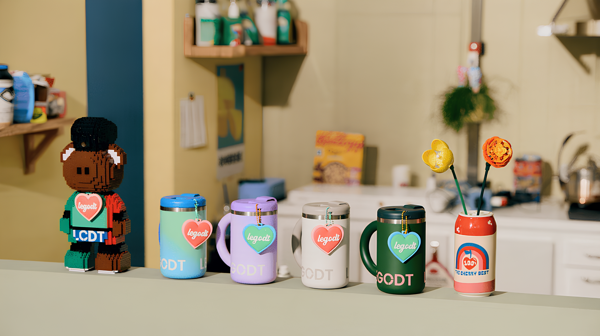
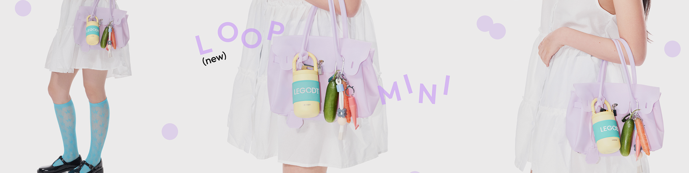

# LEGODT · MAKE DAILY FUN

### 일상에 즐거움을 더하는 레고트 웹 포트폴리오

레고트(LEGODT)의 제품과 브랜드 이야기를 **3D 큐브, 다채로운 제품 비주얼, 스크롤 인터랙션**으로 소개하는 웹 퍼블리싱 프로젝트입니다. 메인 페이지에서 브랜드를 경험하고, 6개의 제품 소개 페이지로 이동하며 컬렉션을 탐색하도록 구성했습니다.

`HTML5` · `CSS3` · `JavaScript` · `Responsive Web`

<!-- GitHub Pages 배포 후 아래에 실제 사이트 URL을 추가하세요. -->
<!-- 예: [사이트 바로가기](실제 배포 URL) -->

## 01. 프로젝트 소개

| 항목 | 내용 |
| :--- | :--- |
| 프로젝트 | LEGODT 브랜드 홈페이지 웹 포트폴리오 |
| 목적 | 브랜드 비주얼과 웹 인터랙션 구현을 소개하는 포트폴리오 발표 |
| 구성 | 메인 페이지 1개 + 제품 소개 서브 페이지 6개 |
| 구현 방식 | HTML, CSS, Vanilla JavaScript 기반 정적 웹사이트 |
| 레이아웃 | 화면 너비에 따라 구성이 달라지는 반응형 스타일 |

## 02. 기획 및 디자인 방향

**MAKE DAILY FUN**이라는 메시지를 중심으로, 제품을 탐색하는 과정에서도 브랜드의 즐거운 분위기가 느껴지도록 구성했습니다.

- **입체적인 첫인상** — 메인 화면의 3D 큐브에 6개의 제품 컬렉션을 배치합니다.
- **제품 중심의 시각 구성** — 큰 이미지와 굵은 타이포그래피로 제품과 메시지를 강조합니다.
- **자연스러운 탐색 흐름** — HOME → PRODUCT → STORY → CONTACT 순서로 브랜드 경험을 이어갑니다.
- **일관된 서브 페이지** — 제품별 비주얼은 달리하면서 소개, 특징, 상품 카드의 구조는 통일합니다.

## 03. 메인 이미지



> 메인 페이지의 PRODUCT 섹션에 사용한 원본 비주얼입니다. 아래 서브 이미지 역시 각 페이지에 사용된 이미지이며, 전체 화면 캡처는 아닙니다.

### 메인 페이지 구성

| 영역 | 주요 내용 | 구현 포인트 |
| :--- | :--- | :--- |
| HOME | 3D 큐브와 브랜드 메시지 | 큐브 자동 회전, 번호 버튼으로 면 선택, 제품 페이지 연결 |
| PRODUCT | 제품 비주얼과 카테고리 | 배경 슬라이드 자동 전환, 페이지네이션, 아이콘 호버 |
| STORY | 브랜드 스토리와 제품 이미지 | 스크롤에 따른 카드 쌓임 연출과 제품명 변경 |
| CONTACT | 브랜드 소셜 계정 안내 | 파스텔 그래픽과 푸터 구성 |

## 04. 서브 이미지

### 01 · 투명하게 만나는 새로운 루프 텀블러


투명한 소재의 제품 비주얼과 특징을 소개하고, 상품 카드에서 색상과 가격 정보를 보여줍니다.

### 02 · 작아진 루프, 더 커진 즐거움



작은 텀블러의 컬러와 형태를 중심으로 컬렉션의 분위기를 전달합니다.

### 03 · 포켓몬과 함께 떠나는 여행


캐릭터와 제품을 결합한 비주얼로 컬렉션의 개성을 보여줍니다.

### 전체 서브 페이지

| 파일 | 소개 콘텐츠 |
| :--- | :--- |
| `products/product-01.html` | 투명 루프 텀블러 |
| `products/product-02.html` | 루프 텀블러 미니 |
| `products/product-03.html` | 포켓몬 컬렉션 |
| `products/product-04.html` | 루프 텀블러 모듈 |
| `products/product-05.html` | 하트 & 튜브 키링 컬렉션 |
| `products/product-06.html` | 루프 텀블러 멀티 |

## 05. 주요 구현 기능

### 3D 큐브 인터랙션

CSS 3D Transform과 JavaScript를 이용해 큐브의 회전 방향을 제어합니다. 번호 버튼을 누르면 해당 면과 소개 문구가 함께 바뀌며, 잠시 후 자동 회전이 재개됩니다. 큐브 클릭 시 선택된 제품의 서브 페이지가 새 탭으로 열립니다.

### 슬라이드와 호버 효과

PRODUCT 영역은 배경 이미지가 자동으로 전환되며, 페이지네이션 버튼으로 직접 선택할 수 있습니다. 카테고리 아이콘과 서브 페이지 상품 카드는 마우스를 올렸을 때 이미지가 바뀝니다.

### 스크롤에 반응하는 화면

현재 위치에 따라 상단 메뉴의 활성 상태와 헤더 스타일이 달라집니다. STORY 영역은 카드가 겹쳐지는 흐름에 맞춰 제품명이 바뀌고, 상단 이동 버튼은 부드러운 스크롤을 제공합니다.

### 반응형 레이아웃

미디어 쿼리를 사용해 화면 너비에 따라 타이포그래피, 큐브 크기, 콘텐츠 배치를 조정합니다.

## 06. 사용 기술

| 기술 | 활용 |
| :--- | :--- |
| HTML5 | 페이지 구조, 섹션 구분, 내비게이션과 제품 콘텐츠 |
| CSS3 | 레이아웃, 3D Transform, 전환 효과, 애니메이션, 미디어 쿼리 |
| JavaScript | 큐브 제어, 슬라이드 전환, 스크롤 상태 감지, 이벤트 처리 |
| Intersection Observer | PRODUCT 영역 진입에 따른 아이콘 등장 처리 |

별도의 프레임워크나 빌드 과정 없이 실행하는 정적 웹사이트입니다.

## 07. 폴더 구조

아래는 원본 웹사이트와 README 이미지 폴더를 함께 배치했을 때의 구조입니다.

```text
.
├── README.md
├── index.html
├── assets/
│   ├── css/          # 메인 및 서브 페이지 스타일
│   ├── fonts/        # 폰트 파일
│   ├── images/       # 사이트 이미지 및 아이콘
│   └── js/           # main.js, subpage.js
├── products/
│   ├── product-01.html
│   ├── product-02.html
│   ├── product-03.html
│   ├── product-04.html
│   ├── product-05.html
│   └── product-06.html
└── docs/
    └── images/       # README용 메인·서브 비주얼
```

## 08. 실행 방법

1. `legodt_web.zip`을 압축 해제합니다.
2. `index.html`과 같은 위치에 `README.md`와 `docs` 폴더를 배치합니다.
3. `index.html`을 브라우저로 열어 확인합니다.

GitHub에는 압축파일 자체가 아닌 **압축 해제한 웹사이트 파일과 README.md, docs 폴더**를 함께 업로드합니다. README 이미지는 상대 경로로 연결되어 있으므로 `docs/images` 구조를 유지합니다. 배포가 완료되면 README 상단에 실제 사이트 링크를 추가합니다.

## 09. 발표 시연 순서

1. **기획 소개** — 일상의 즐거움을 웹 화면과 인터랙션으로 표현한 방향을 설명합니다.
2. **메인 시연** — 큐브 자동 회전과 번호 선택, 제품 페이지 연결을 보여줍니다.
3. **스크롤 시연** — PRODUCT 슬라이드와 STORY 카드 연출을 소개합니다.
4. **서브 시연** — 제품별 비주얼, 상품 카드 호버, 색상 선택 표시를 보여줍니다.
5. **반응형 확인** — 브라우저 너비를 조절하며 화면 구성이 바뀌는 모습을 보여줍니다.

## 10. 구현 범위

브랜드 및 제품 소개 화면과 프런트엔드 인터랙션을 중심으로 제작한 포트폴리오입니다. 검색, 장바구니, 결제, 사이트맵, 일부 More 및 Follow us 버튼은 실제 서비스와 연결되어 있지 않습니다. 상품의 색상 버튼은 선택 상태를 표시하며, 주문이나 상품 옵션 저장 기능은 포함하지 않습니다.

브랜드명, 로고 및 제품 이미지의 권리는 각 권리자에게 있습니다.
